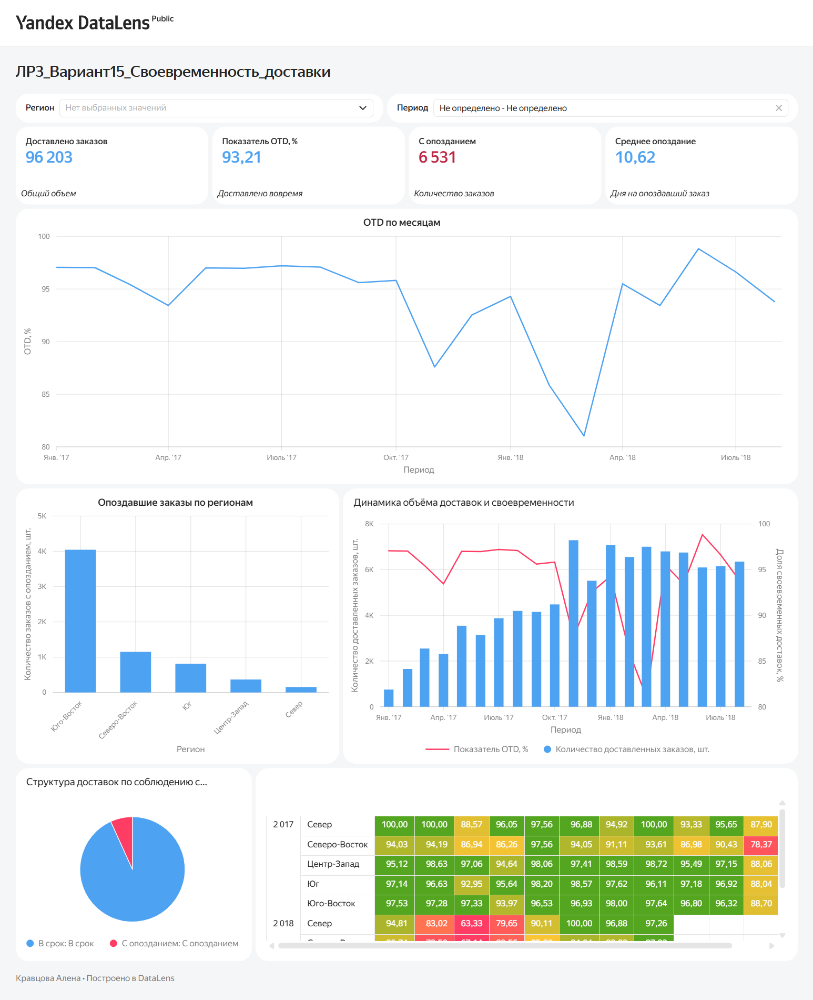
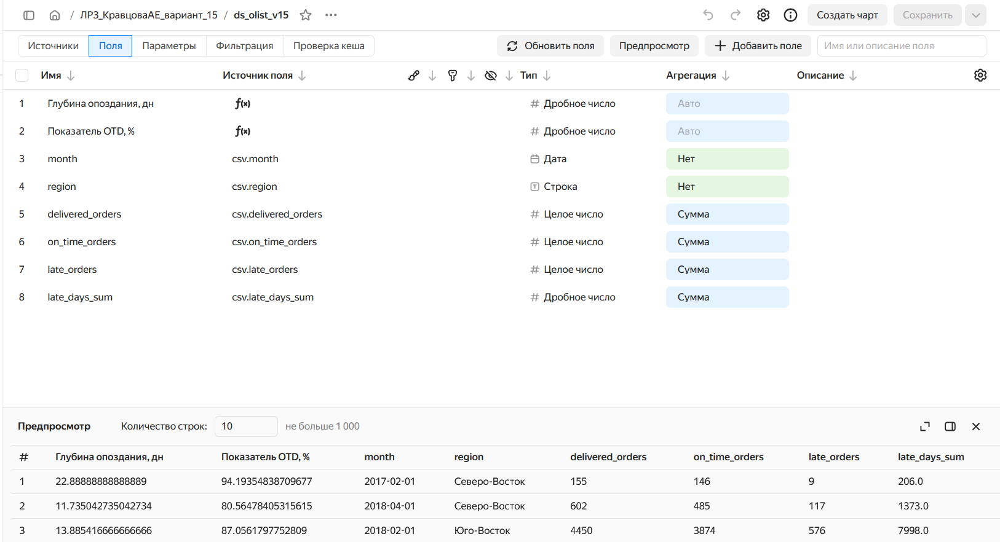
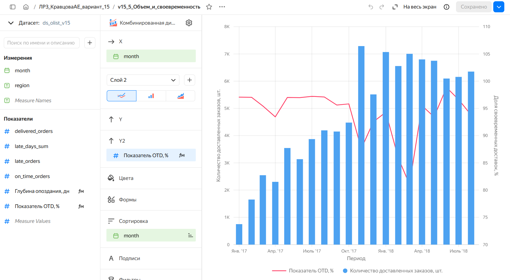

# Лабораторная работа № 3
**Студент** - Кравцова А.Е.
**Вариант:** 15 - Своевременность доставки (OTD)

**Дашборд Yandex DataLens** (https://datalens.yandex/1d1mt3436spok?_share_link=public)
---

## 1. Цель работы

Цель лабораторной работы - разработка аналитического решения для оценки своевременности доставки заказов маркетплейса Olist с использованием Python, SQLite и Yandex DataLens, подготовить интерактивный дашборд, содержащий исчерпывающие сведения для управления

### Основные задачи

1. Загрузить и проанализировать исходные данные Olist
2. Выполнить очистку и преобразование данных
3. Сформировать аналитическую SQL-витрину
4. Рассчитать показатели своевременности доставки (OTD)
5. Разработать интерактивный аналитический дашборд
6. Выявить проблемные периоды и регионы
7. Сформулировать управленческие выводы и рекомендации

### Бизнес-задача

**Определить, насколько вовремя выполняется доставка заказов, в каких регионах и периодах происходят наибольшие задержки, какие управленческие решения могут повысить качество логистических процессов?**

---
## 2. Источник данных

Используется **Brazilian E-Commerce Public Dataset by Olist** — открытые обезличенные сведения о работе маркетплейса за 2016–2018 годы: около 99 тыс. заказов и девять взаимосвязанных таблиц.
**Источник:** [Kaggle — Brazilian E-Commerce](https://www.kaggle.com/datasets/olistbr/brazilian-ecommerce)

В исходных данных представлены:
- Заказы покупателей.
- Информация о клиентах.
- Позиции заказов.
- Платежи.
- Отзывы покупателей.
- Товары и товарные категории.
- Продавцы.
- Географические сведения.

**Анализируемый период:** январь 2017 — август 2018 года.

### Используемые технологии

| Технология | Назначение |
|---|---|
| Python | Загрузка и обработка данных |
| Pandas | Анализ и преобразование данных |
| SQLite | Хранение и подготовка данных |
| SQL | Формирование аналитических витрин |
| Google Colab / Jupyter | Выполнение аналитического конвейера |
| Yandex DataLens | Визуализация результатов |
| GitHub | Публикация результатов |

---

## 3. Архитектура аналитического решения

Обработка данных организована по многоуровневой архитектуре:

**RAW -> STAGING -> CORE -> DATAMART -> DataLens**

### RAW

Загрузка исходных CSV-файлов в SQLite без изменения исходных значений

### STAGING

Очистка и подготовка данных:
- Приведение типов
- Обработка отсутствующих значений
- Устранение дублирования
- Нормализация категорий
- Проверка корректности данных

### CORE

Формирование согласованной модели данных, содержащей информацию о заказах, позициях заказов и географических регионах

### DATAMART

Создание аналитической SQL-витрины: `dm_v15_otd_monthly`

### Yandex DataLens

Подключение CSV-файла, создание вычисляемых показателей в датасете, формирование диаграмм. Объедининие чартов в единый дашборд, создание селекторов для поиска и фильтрации данных

---

## 4. Анализ качества исходных данных

### Проблема 1. Отсутствующие даты доставки

**Проблема:** обнаружены 2 965 заказов без фактической даты доставки, включая 8 заказов со статусом `delivered`. У 160 заказов отсутствует дата одобрения.

**Чем опасна:** отсутствие дат приводит к некорректному расчёту сроков доставки и искажению показателя OTD.

**Как исправлена:** выполнена нормализация дат на этапе STAGING. Для расчёта своевременности используются только доставленные заказы с заполненными фактическими и плановыми датами доставки.

### Проблема 2. Дублирование отзывов

**Проблема:** выявлены 547 заказов с несколькими отзывами.

**Чем опасна:** при объединении таблиц повторяющиеся отзывы могут приводить к дублированию заказов и завышению аналитических показателей.

**Как исправлена:** использована оконная функция `ROW_NUMBER()`, позволяющая выбрать один отзыв для каждого заказа.

### Проблема 3. Некорректные географические данные

**Проблема:** выявлены 42 географические точки за пределами допустимого диапазона координат. Также обнаружены пропуски в товарных категориях.

**Чем опасна:** некорректные географические данные могут искажать территориальные группировки и результаты регионального анализа.

**Как исправлена:** выполнена проверка координат, обработаны отсутствующие категории. Регион доставки определяется по штату покупателя.

---

## 5. Аналитическая SQL-витрина

Разработана витрина: `dm_v15_otd_monthly`

### Структура витрины

| Поле | Описание |
|---|---|
| `month` | Месяц оформления заказа |
| `region` | Регион доставки |
| `delivered_orders` | Количество доставленных заказов |
| `on_time_orders` | Количество своевременных доставок |
| `late_orders` | Количество доставок с опозданием |
| `late_days_sum` | Суммарная продолжительность опозданий, дней |

Витрина содержит **100 строк**, соответствующих комбинациям месяцев и регионов.

### Основные показатели

**1. Своевременность доставки (OTD)**

OTD показывает долю заказов, доставленных не позднее обещанной даты.

Формула расчета в DataLens: `SUM([on_time_orders]) / SUM([delivered_orders]) * 100`

**2. Доля опоздавших заказов**

`SUM([late_orders]) / SUM([delivered_orders]) * 100`

**3. Средняя продолжительность опоздания**

`SUM([late_days_sum]) / SUM([late_orders])`

---

## 6. Контрольные расчёты

По результатам анализа получены следующие значения:

| Показатель | Значение |
|---|---:|
| Всего доставленных заказов | 96 203 |
| Доставлено вовремя | 89 672 |
| Доставлено с опозданием | 6 531 |
| Своевременность доставки (OTD) | 93,21% |
| Доля опоздавших заказов | 6,79% |
| Средняя продолжительность опоздания | 10,62 дня |
| Месяц с минимальным OTD | Март 2018 |
| OTD в марте 2018 года | 81,04% |

### Ответы на контрольные вопросы

**Вопрос 1. Какова общая своевременность доставки?**

Общий показатель OTD составляет **93,21%**.

**Вопрос 2. В каком месяце наблюдалась минимальная своевременность доставки?**

Минимальное значение OTD зафиксировано в **марте 2018 года — 81,04%**.

---

## 7. Аналитический дашборд

Ссылка на дашборд (https://datalens.yandex/1d1mt3436spok?_share_link=public)

### 7.1. Ключевые показатели (KPI)

В дашборде представлены:

- Общее количество доставленных заказов.
- Количество своевременных доставок.
- Количество заказов с опозданием.
- Доля своевременных доставок (OTD).
- Доля опоздавших заказов.
- Средняя продолжительность опоздания.

### 7.2. Основные диаграммы

| Диаграмма | Назначение |
|---|---|
| Индикатор OTD | Оценка общей своевременности доставки |
| Линейная диаграмма OTD | Анализ изменения своевременности по месяцам |
| Столбчатая диаграмма | Сравнение количества опозданий по регионам |
| Круговая диаграмма | Структура своевременных и несвоевременных доставок |
| Комбинированная диаграмма | Совместный анализ объёма заказов и OTD |

### 7.3. Дополнительная аналитика

Для углублённого анализа сформированы дополнительные визуализации.

**Тепловая карта своевременности доставки**

Отражает OTD по годам, месяцам и регионам. Используется для выявления периодов ухудшения качества доставки и сравнения региональных показателей.

**Динамика средней продолжительности опоздания**

Позволяет оценивать не только количество задержек, но и их длительность.

**Сравнение регионов по доле опозданий**

Позволяет сопоставлять качество доставки в регионах независимо от различий в количестве заказов.

### 7.4. Интерактивные селекторы

Дашборд содержит два селектора:

1. **Регион** — фильтрация аналитических показателей по регионам доставки.
2. **Период** — выбор временного интервала анализа.

### 7.5. Скриншоты

**Общий вид аналитического дашборда**

**Датасет и вычисляемые поля**

**Настройка аналитической диаграммы**

---

## 8. Анализ результатов

### Вывод 1. Общая эффективность доставки

За анализируемый период было доставлено **96 203 заказа**, из которых **89 672** выполнены своевременно.

Общий показатель OTD составляет **93,21%**.

С опозданием доставлен **6 531 заказ**, что соответствует **6,79%** от общего количества.

Несмотря на высокую общую долю своевременных доставок, количество задержек остаётся значительным.

### Вывод 2. Снижение качества доставки в марте 2018 года

Минимальная своевременность доставки зафиксирована в **марте 2018 года — 81,04%**.

В течение месяца из 7 003 доставленных заказов **1 328** были доставлены с опозданием.

Согласно тепловой карте, снижение OTD наблюдалось во всех пяти регионах:

| Регион | OTD в марте 2018 |
|---|---:|
| Север | 63,33% |
| Северо-Восток | 67,14% |
| Центр-Запад | 77,08% |
| Юг | 82,89% |
| Юго-Восток | 83,25% |

Одновременное снижение показателей в нескольких регионах может свидетельствовать о наличии общих факторов, влияющих на качество доставки.

### Вывод 3. Региональные различия

Наиболее низкий OTD за анализируемый период наблюдался в **Северо-Восточном регионе — 87,24%**.

В данном регионе с опозданием доставлено **1 150 заказов**.

При этом наибольшее абсолютное количество задержек приходится на **Юго-Восточный регион — 4 045 заказов**.

Это показывает, что при оценке логистических процессов необходимо учитывать не только число опозданий, но и их долю относительно общего объёма доставок.

### Вывод 4. Продолжительность опозданий

Средняя продолжительность опоздания составляет **10,62 календарного дня**.

Данный результат показывает, что для оценки качества логистики недостаточно контролировать только OTD.

Необходимо дополнительно анализировать глубину задержек, поскольку опоздание на один день и на десять дней имеет разное значение для качества обслуживания покупателей.

---

## 9. Управленческие рекомендации

По результатам исследования предлагаются следующие мероприятия.

### 9.1. Введение целевого показателя OTD

Установить целевой уровень своевременности доставки **95%**.

Текущее значение составляет 93,21%, отклонение — **1,79 %**.

Использовать данный ориентир для контроля динамики качества доставки.

### 9.2. Приоритетный анализ проблемных регионов

Особое внимание уделить Северо-Восточному региону, имеющему минимальный OTD. Для Юго-Восточного региона приоритетом должно стать сокращение абсолютного количества задержек.

### 9.3. Анализ периодов ухудшения качества

Провести дополнительное исследование причин снижения OTD в марте 2018 года с учетом:
- Сезонных колебаний
- Изменения количества заказов
- Соблюдения сроков обработки и отгрузки
- Возможных отклонений в логистических процессах

### 9.4. Контроль продолжительности задержек

Наряду с OTD использовать показатель средней глубины опоздания.

Это позволит выявлять периоды, в которых задержки имеют наиболее серьёзный характер.

---
